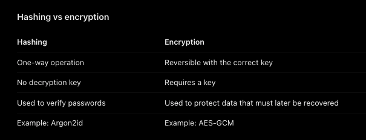

# Authentication & Authorization

- How do we prove who the user is initially? -> Login Authentication
- How do we recognize them on subsequent request without requiring there password
  each time? -> for this we have session or token mechanism

## The fundamental pattern

1. Login and Verify Identity
2. Issue an authentication credential
3. Client presents this on later requests
4. Backend validates it and checks permissions

- A session identifier and an access token are 2 ways to support this flow.

#### What is the meaning that HTTP is stateless?
- HTTP being stateless does not mean that server can not store the data.
- It means HTTP itself doesn't automatically associates separate requests with the same authenticated users.

## Authentication vs Authorization
**Authentication**: Who is making the request and have they proved their identity? (who is this user)
**Authorization**: Is this authenticated user allowed to perform this action on this resource? (what can you access?)

**403 forbidden is there to let know that user is authenticated but not permitted.**
- 401 is unauthorized: authentication is missing or invalid, no valid session/token
- 403 Forbidden: Access is not permitted. For example, normal user trying an admin-only action.

- In this project, we will use **Argon2id** as the hashing algorithm.

#### What is salt, and why do we need one?
- Suppose Rahul and Priya both use the password: hello123
- Now, if we are not using salt, the same password produces the same hash with a deterministic hashing algorithm
- An attacker who steals steals the database can recognize that both accounts share a password
- That is why we use salt, it is a unique and random value used when hashing each password
- **We do not have to implement salts manually. Modern libraries such as Argon2 handle generating and incorporating salts for you**

